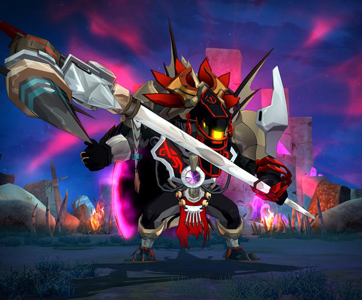
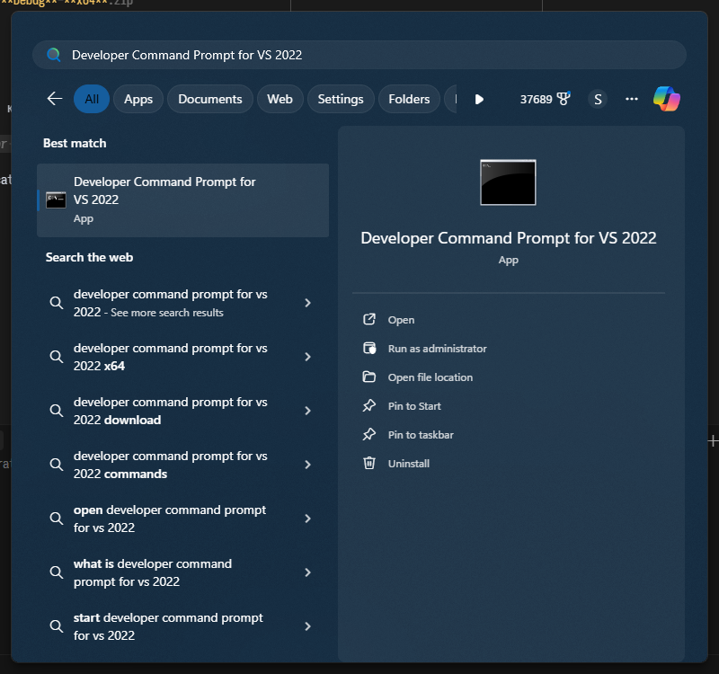
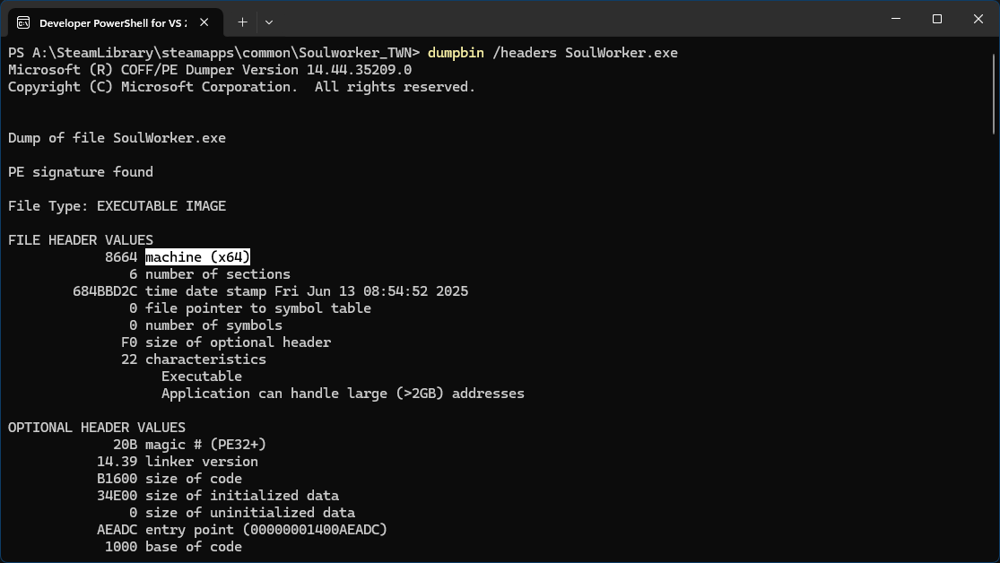

# Introduction

## Shimida

## Prerequisites

- Install [plugin loader](https://github.com/SoulWorkerResearch/swp-loader/#how-to).
  > I strongly recommend that you use the **DEBUG** build of [plugin loader](https://github.com/SoulWorkerResearch/swp-loader/releases) for development.

- The architecture of the loader, plugin and game must match.

- Bootstrap [vcpkg](https://learn.microsoft.com/en-us/vcpkg/get_started/get-started-msbuild?pivots=shell-powershell#1---set-up-vcpkg) for manage dependencies.
  > - Only <ins>Set up vcpkg</ins> step.
  > - VISUAL STUDIO MUST BE CLOSED.

### Example of loader name for

- **<ins>x64</ins>** game for **<ins>development</ins>**: swp-loader-v4.0.0-**<ins>Debug</ins>**-**<ins>x64</ins>**.zip

- **<ins>x64</ins>** game for **<ins>everyday use</ins>**: swp-loader-v4.0.0-**<ins>Release</ins>**-**<ins>x64</ins>**.zip

## Game Architecture

### If you're not sure, or don't know what architecture the game uses, then:

- Find and start "Developer Command Prompt for VS".
  > Microsoft visual studio must be installed.
  > In my case it is Visual Studio Community 2022

  

- Navigate tot game directory.
  > `cd "game folder"`

- Print and press enter: `dumpbin /headers "exe name"`
  > The white background highlights the architecture of the game.

  

### If you're dont know where game are installed, then:

- Nothing's gonna help you anymore.