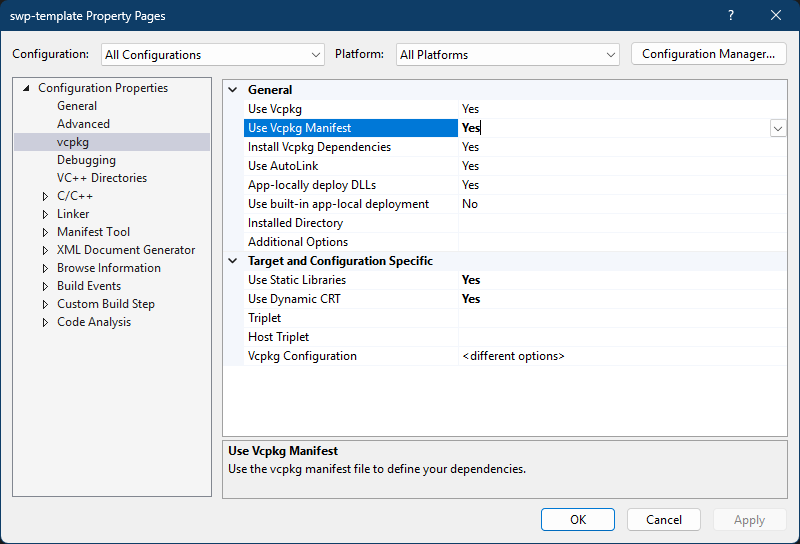

# Dependencies

## What and for

First of all, it is necessary to add the core dependencies.

| What                                                | For                 |
| --------------------------------------------------- | ------------------- |
| [spdlog](https://github.com/gabime/spdlog)          | logging             |

## Manifest

The final manifest file should look something like this.

> Put this in vcpkg.json in root directory of your plugin (<ins>where .sln</ins>).

```json
{
  "name": "you plugin name",
  "version": "1.0.0",
  "dependencies": ["spdlog"]
}
```

> If you do not understand what this is about, read next article: [What is manifest mode?](https://learn.microsoft.com/en-us/vcpkg/concepts/manifest-mode/).


## Vcpkg status

Set **Use Vcpkg Manifest** to **true** in the settings of the created project.

